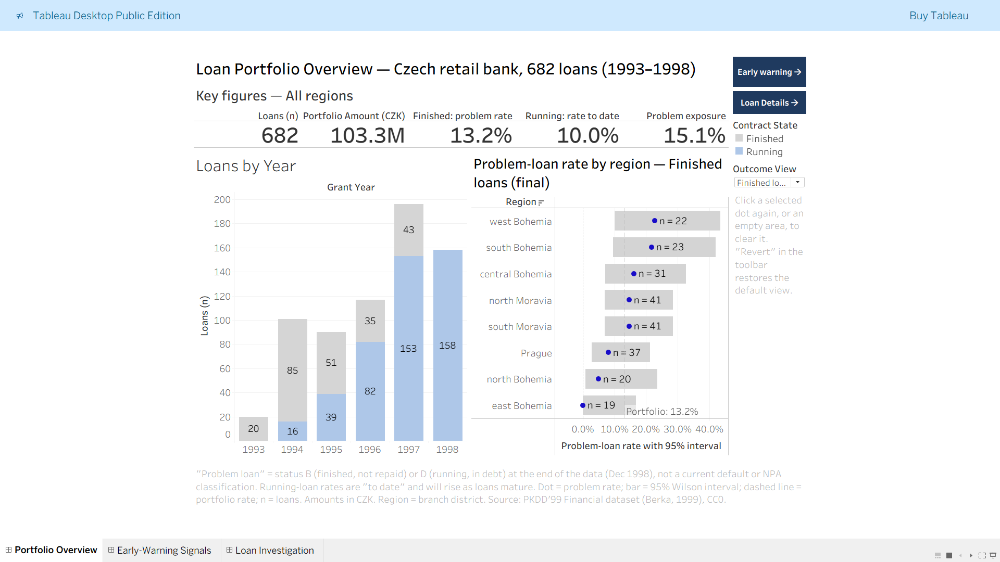

# Banking Loan-Risk Analytics — Early-Warning Signals in a Retail Loan Portfolio

**Interactive dashboard:** [Tableau Public](https://public.tableau.com/app/profile/manikanta.reddy.kristipati4204/viz/BankingLoan-RiskAnalyticsEarly-WarningSignalsinaRetailLoanPortfolio/PortfolioOverview)

An end-to-end analytics project on real, anonymized data from a Czech retail bank:
data validation and profiling in Python, a layered SQL Server model (staging → core → mart),
point-in-time feature engineering in T-SQL, and an interactive three-page Tableau application.



---

## Business question

> Which signals in a customer's account **before** a loan is granted are associated with that
> loan later becoming a problem loan — and do problem-loan rates genuinely differ by region,
> or is that noise from small samples?

**Baseline:** 76 of 682 loans (11.1%) are problem loans (status B or D).

Scope: descriptive and diagnostic analysis. No predictive model, and no causal claims.

---

## Data

| Item | Detail |
|---|---|
| Dataset | PKDD'99 Financial dataset ("Berka dataset"), Berka, P. (1999), Workshop notes on Discovery Challenge PKDD'99 |
| Source used | Kaggle mirror ["The Berka Dataset"](https://www.kaggle.com/datasets/marceloventura/the-berka-dataset) — licence **CC0 1.0** (the original CTU repository server was unreachable on port 3306) |
| Original documentation | [PKDD'99 Discovery Challenge](https://sorry.vse.cz/~berka/challenge/pkdd1999/berka.htm) · [CTU Relational Repository](https://relational.fel.cvut.cz/dataset/Financial) |
| Tables | account 4,500 · client 5,369 · disposition 5,369 · permanent order 6,471 · transaction 1,056,320 · loan 682 · card 892 · district 77 |
| Period | Transactions 1993-01-01 to 1998-12-31; loans granted 1993-07-05 to 1998-12-08 |
| Currency | Czech koruna (CZK) |

Raw data is not stored in this repository (the transaction file exceeds GitHub's
recommended file size). Download it from Kaggle into `data/raw/` — see *Reproduce*.

---

## Architecture

```
Kaggle CSVs ──► Python (validate, profile) ──► SQL Server 2025 Express  (BankAnalytics)
                                                 stg  : raw text, exact copy of source
                                                 core : typed, labelled, constrained tables
                                                 mart : one row per loan, point-in-time features
                                                        │
                                   Python export ◄──────┘
                                        │
                                        ▼
            data/processed/loan_features.csv ──► Tableau Desktop Public Edition ──► Tableau Public
```

| Tool | Why |
|---|---|
| Python (pandas, pyodbc) | Reproducible validation and profiling; the transaction table exceeds Excel's row limit |
| SQL Server (T-SQL) | Layered model, constraints, window functions, point-in-time features, reconciliation |
| Tableau Desktop Public Edition | Interactive dashboards; reads the exported mart (Public Edition connects to files) |

---

## Repository structure

```
├── README.md
├── data/
│   ├── raw/                     # Kaggle CSVs (not committed)
│   └── processed/
│       └── loan_features.csv    # exported mart, 682 rows × 37 columns
├── scripts/
│   ├── 01b_validate_raw.py      # row counts vs documentation
│   ├── 02_profile_data.py       # keys, orphans, cardinality, categories, dates, business rules
│   └── 05_export_mart.py        # SQL Server → CSV, with validation of the written file
├── sql/
│   ├── 03a_create_staging.sql   # database, schemas, all-text staging tables
│   ├── 03b_load_staging.sql     # BULK INSERT + reconciliation + load-artifact checks
│   ├── 03c_build_core.sql       # typed core tables, lookup labels, constraints, negative test
│   ├── 03d_investigate_trans.sql    # LAG ledger test for undocumented transaction type
│   ├── 03d_clean_ledger_test.sql    # same test on unambiguous same-day rows
│   ├── 03d_build_core_trans.sql     # core transaction table, amount control total, index
│   └── 04_build_mart.sql        # loan-level mart with 90-day pre-loan features
├── docs/
│   ├── data_quality_report.txt
│   ├── column_profile.csv
│   └── kpi_definitions.md
├── tableau/                     # workbook (also downloadable from Tableau Public)
└── images/                      # dashboard screenshots
```

---

## Data quality and validation

Every stage was reconciled against an independent number before moving on.

| Check | Result |
|---|---|
| Row counts vs documentation (8 tables) | All match, including 1,056,320 transactions |
| Primary-key duplicates / orphaned foreign keys | 0 / 0 |
| Owners per account | Exactly 1 for all 4,500 accounts → loan-to-owner joins cannot fan out |
| Load into SQL Server | Row counts match; transaction amount total 6,257,793,560.30 identical in staging and core |
| Loan interest | amount = monthly payment × duration for **all 682 loans** → no interest data, so no profit/loss metrics |

Issues found and how they were handled:

- **Undocumented transaction type `VYBER` (16,666 rows).** Tested with a `LAG`-based ledger check
  (does the balance move by ± amount?). Validated on known credits/debits first; same-day ordering
  noise isolated by testing only unambiguous days (credits 97.0% up, debits 99.6% down,
  `VYBER` 100% down on 9,597 rows) → treated as a debit, original code kept.
- **Blank `operation` (183,114 rows)** = exactly the interest postings → labelled, enforced by a CHECK constraint.
- **Two forms of blank** (empty and single space) → standardized to NULL; reconciled to 535,314.
- **Within-day transaction order unknown** (dates only) → only order-independent features used.
- **~5,300 unambiguous transactions** do not reconcile to ± amount — cause unknown, documented.
- **30 loans (4.4%) with owners under 18** at the grant date (decoded birth numbers) — kept, flagged as a data anomaly.
- **District `?` values** (1995 unemployment and crime) → the complete 1996 columns are used instead.

---

## Analytical design

- **Finished vs running loans are never mixed.** Finished loans (A/B) have a final outcome;
  running loans (C/D) are right-censored, so their rate is labelled "to date".
- **"Problem loan"** = status B or D at the end of the data (Dec 1998) — not a current default or NPA classification.
- **Point-in-time features:** only transactions in the 90 days **strictly before** the grant date
  (every loan has ≥102 days of history, so every loan has a full window). No outcome leakage.
- **Uncertainty shown everywhere:** every rate carries its loan count and a 95% Wilson interval.
- **Bands merged** when fewer than 20 finished loans (decided on counts only, before rates), except the overdraft group.

KPI definitions (numerators, denominators, limitations): [`docs/kpi_definitions.md`](docs/kpi_definitions.md)

---

## Key findings

Associations in historical data, not causes.

| | Finished loans | Running loans (to date) |
|---|---|---|
| Loans · problem loans · rate | 234 · 31 · **13.2%** (9.5–18.2%) | 448 · 45 · **10.0%** (7.6–13.2%) |

**1. Low minimum balance before the loan is the strongest signal found.**
Loans whose account balance fell below 10,000 CZK in the 90 days before the loan:

| | Finished | Running (to date) |
|---|---|---|
| Min balance < 10k | 12 / 26 = **46.2%** (28.8–64.5%) | 28 / 67 = **41.8%** (30.7–53.7%) |
| Min balance ≥ 10k | 19 / 208 = **9.1%** (5.9–13.8%) | 17 / 381 = **4.5%** (2.8–7.0%) |
| Share of loans flagged | 11.1% | 15.0% |
| Share of problem loans caught | 38.7% | 62.2% |

The intervals do not overlap in either view.

**2. An overdraft in the 90 days before the loan was rare but always followed by a problem.**
15 of 15 such loans became problem loans (finished 3/3, 95% interval 43.8–100%;
running 12/12, 75.7–100%) — high precision, but only 10–27% of problem loans are caught.

**3. Payment relative to account inflows rises with problem rates.**
Finished: 8.9% → 18.8% → 39.1%; running: 6.6% → 17.0% → 38.7%
(monthly payment < 25% / 25–50% / ≥ 50% of average monthly inflows).
Caveat: 14 loans have ratios above 100% because little money flowed into *this* account — the measure is not verified income.

**4. Regional differences are mostly within chance.**
Finished problem rates range from 0% to 22.7% by region, but with 19–41 loans per region every
95% interval contains the portfolio rate. North Bohemia is consistently low (1/20 finished;
0/41 running, interval 0–8.6%), not explained by loan age (18.1 months observed on average),
but it is 1 result among 16 comparisons — a lead to monitor, not a basis for policy.

**5. Problem loans are larger than average:** 11.1% of loans by count but 15.1% of lending.

---

## Recommendations

1. **Pilot a manual-review trigger** for applications whose balance fell below a threshold in the
   previous 90 days. The dashboard's what-if slider shows the workload/capture trade-off
   (at 10,000 CZK: ~11–15% of applications reviewed, 39–62% of problem loans flagged).
2. **Validate any threshold on new loans** before adopting it — all figures here are in-sample.
3. **Do not set region-specific lending rules** on this evidence; re-check as more loans finish.
4. **Report finished and running loans separately** in portfolio monitoring; a single blended
   "default rate" understates the eventual rate.

---

## Dashboard features

| Page | What it does |
|---|---|
| **Portfolio Overview** | KPI cards, lending by year (finished vs running), problem rate by region with 95% intervals and a portfolio benchmark (LOD) |
| **Early-Warning Signals** | What-if minimum-balance threshold with live precision/capture KPIs; flagged vs not flagged; minimum balance and payment-burden bands |
| **Loan Investigation** | Loan-level table reached by drill-through from any chart |

Interactions: parameter to switch finished/running loans (drives titles and benchmarks),
click a region to filter the KPI cards and year chart, tooltip links for drill-through to the
underlying loans, plain-language tooltips ("Above / Below / Not distinguishable from the portfolio rate"),
navigation buttons, and a clean default state for Tableau Public's Revert.

---

## Limitations

- Historical data (1993–1998) from one bank; amounts in CZK.
- No interest, fees on loans, recoveries or costs → exposure is reported, never loss or profit.
- Small groups: 31 finished problem loans in total; intervals are wide.
- All thresholds are explored on the same data they describe (in-sample).
- Account inflows are not verified income.
- Region = branch district of the account, not the client's home district.

---

## Reproduce

1. Download the 8 CSVs from the Kaggle dataset into `data/raw/`.
2. `python scripts/01b_validate_raw.py` and `python scripts/02_profile_data.py`.
3. Copy the CSVs to `C:\BankData\raw` (readable by the SQL Server service), then run in SSMS in order:
   `03a` → `03b` → `03c` → `03d_build_core_trans` → `04_build_mart`
   (the two `03d` investigation scripts are read-only and optional).
4. `python scripts/05_export_mart.py` (set `SERVER` to your instance).
5. Open the workbook from Tableau Public, or connect Tableau to `data/processed/loan_features.csv`.

Each script ends with validation queries and the expected results.

---

## Author

**Manikanta Reddy Kristipati** — M.Tech Data Science and Engineering, NIT Agartala
